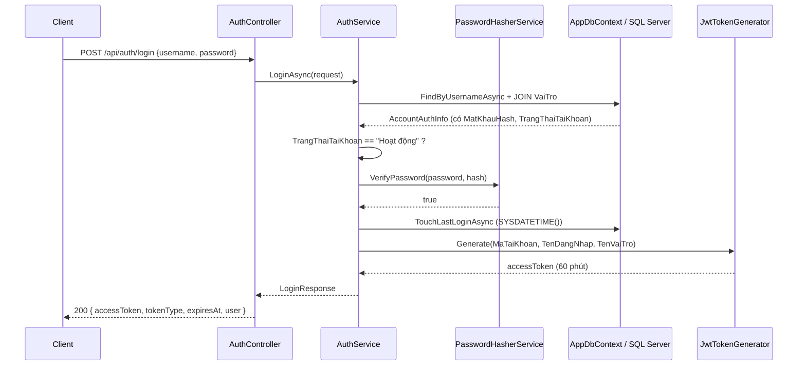

# Phase 2 — Authentication / JWT / Authorization

> Trạng thái: **HOÀN THÀNH** — build sạch 0 warning, **39/39 test case PASS** trên database thật.

## 1. Phạm vi

| Có làm | KHÔNG làm (phase sau) |
|---|---|
| Login / Logout (client) / JWT access token | Refresh token, token revocation |
| Password hashing (ASP.NET Core Identity PBKDF2) | Forgot password, email reset |
| Role authorization theo `VaiTro` thật trong DB | CRUD nghiệp vụ, WinForms UI, Next.js UI |
| `/api/auth/me`, `/api/auth/change-password` | Redis, Docker, CQRS, MediatR, GenericRepository, UnitOfWork |
| Swagger Bearer authorization | Migration / thay đổi schema |

## 2. Luồng authentication



Sau đó client gửi `Authorization: Bearer <token>`; `UseAuthentication` xác thực chữ ký/issuer/audience/lifetime, `UseAuthorization` kiểm tra `[Authorize]` / `[Authorize(Roles = ...)]`.

## 3. Kiến trúc

```
LanguageCenter.Domain/
├── Constants/RoleNames.cs            7 vai trò — giá trị khớp 100% bảng VaiTro
└── Constants/AccountStatuses.cs      Hoạt động / Bị khóa / Ngừng sử dụng

LanguageCenter.Application/
├── Abstractions/
│   ├── IAccountStore.cs              cổng truy cập dữ liệu tài khoản (4 method hẹp)
│   ├── AccountAuthInfo.cs            DTO nội bộ
│   ├── IPasswordHasherService.cs
│   └── IJwtTokenGenerator.cs         + JwtTokenResult
└── Auth/
    ├── IAuthService.cs / AuthService.cs   ← TOÀN BỘ logic
    ├── LoginResult.cs / ChangePasswordResult.cs
    ├── PasswordPolicy.cs
    ├── AuthMessages.cs
    └── Models/ LoginRequest, LoginResponse, CurrentUserDto, ChangePasswordRequest

LanguageCenter.Infrastructure/
├── Authentication/
│   ├── JwtSettings.cs                + FromConfiguration() + Validate()
│   ├── JwtTokenGenerator.cs          JsonWebTokenHandler, HS256
│   └── PasswordHasherService.cs      PasswordHasher<TaiKhoan>
└── Persistence/AccountStore.cs       EF Core implementation

LanguageCenter.Api/
├── Extensions/AuthenticationExtensions.cs    AddJwtAuthentication()
├── Extensions/ClaimsPrincipalExtensions.cs   GetMaTaiKhoan/GetTenDangNhap/GetVaiTro
├── Extensions/DevelopmentEndpointsExtensions.cs
├── Controllers/AuthController.cs
└── Extensions/SwaggerExtensions.cs           + Bearer scheme
```

**Quy tắc tuân thủ:** Controller không chứa logic, không try/catch. Application không phụ thuộc Api/EF Core/Identity. Domain không phụ thuộc ASP.NET Core Identity.

## 4. Password hashing

- `Microsoft.AspNetCore.Identity.PasswordHasher<TaiKhoan>` (chuẩn ASP.NET Core)
- **PBKDF2-HMAC-SHA512**, salt ngẫu nhiên 128-bit, **100.000 vòng lặp**, hash 84 ký tự Base64
- Không MD5/SHA1/plain text. Không tự viết thuật toán.
- `VerifyPassword` trả `false` khi hash sai định dạng (không ném exception) → an toàn với dữ liệu placeholder cũ.
- Hash **không bao giờ** được trả ra API, không ghi log.

## 5. JWT

### Claims (không dùng claim-mapping, `MapInboundClaims = false`)

| Claim | Giá trị | Ví dụ |
|---|---|---|
| `sub` | MaTaiKhoan | `1` |
| `unique_name` | TenDangNhap | `ADMIN001` |
| `role` | TenVaiTro — **nguyên tiếng Việt** | `Quản trị viên` |
| `jti` | GUID định danh token | `9f2c...` |
| `iss` / `aud` / `iat` / `nbf` / `exp` | chuẩn | |

### Cấu hình

`appsettings.json` (không nhạy cảm):

```jsonc
"Jwt": {
  "Issuer": "LanguageCenter.Api",
  "Audience": "LanguageCenter.Clients",
  "AccessTokenExpirationMinutes": 60
}
```

**`Jwt:Key` — KHÔNG có trong appsettings.json.** Lấy từ User Secrets:

```powershell
dotnet user-secrets init --project backend/LanguageCenter.Api/LanguageCenter.Api.csproj
dotnet user-secrets set "Jwt:Key" "<chuỗi Base64 >= 32 byte>" --project backend/LanguageCenter.Api/LanguageCenter.Api.csproj
```

Hoặc dùng task **phase2-secrets** trong VS Code — tự sinh key 64 byte bằng CSPRNG.

- Key lưu tại `%APPDATA%\Microsoft\UserSecrets\<UserSecretsId>\secrets.json` → **ngoài repo, không thể commit**
- `JwtSettings.Validate()` chạy lúc khởi động: thiếu key / sai Base64 / < 32 byte → **app không start** (fail fast)

### Validation (đầy đủ, không nới lỏng)

| Kiểm tra | Giá trị |
|---|---|
| `ValidateIssuer` | `true` |
| `ValidateAudience` | `true` |
| `ValidateLifetime` | `true` |
| `ValidateIssuerSigningKey` | `true` |
| `ClockSkew` | `TimeSpan.Zero` (không cho lệch 5 phút mặc định) |

> Lưu ý: Windows có thể cần **cấu hình lại `Jwt:Key` khi clone sang máy khác** — User Secrets không nằm trong Git.

## 6. Role authorization

`RoleNames` là `const string` (bắt buộc để dùng trong attribute):

| Constant | Giá trị (khớp DB) |
|---|---|
| `RoleNames.QuanTriVien` | `Quản trị viên` |
| `RoleNames.NhanVienHocVu` | `Nhân viên học vụ` |
| `RoleNames.NhanVienTuVan` | `Nhân viên tư vấn` |
| `RoleNames.NhanVienKeToan` | `Nhân viên kế toán` |
| `RoleNames.GiaoVien` | `Giáo viên` |
| `RoleNames.TroGiang` | `Trợ giảng` |
| `RoleNames.HocVien` | `Học viên` |

## 7. Endpoints

| Method | Path | Auth | Mô tả |
|---|---|---|---|
| POST | `/api/auth/login` | anonymous | 200 (token) / 400 / **401** |
| GET | `/api/auth/me` | `[Authorize]` | 200 / 401 |
| POST | `/api/auth/change-password` | `[Authorize]` | 204 / 400 / 401 |
| GET | `/api/development/authenticated` | `[Authorize]` | chỉ Development |
| GET | `/api/development/admin-only` | `Quản trị viên` | chỉ Development |
| GET | `/api/development/teacher-only` | `Giáo viên` | chỉ Development |

Endpoint `/api/development/*` **chỉ được đăng ký khi `IsDevelopment()`** → ở Production trả 404 thật (không phải "có route rồi chặn bằng if").

## 8. Quyết định thiết kế có chủ ý

| Quyết định | Lý do |
|---|---|
| **Mọi lỗi login đều trả 401 + cùng 1 message** `"Tên đăng nhập hoặc mật khẩu không đúng."` (kể cả tài khoản bị khóa) | Chống **account enumeration**. Lý do thật (`InvalidCredentials` / `AccountNotActive`) chỉ ghi **server log** |
| `LanDangNhapCuoi` / `NgayCapNhat` dùng **`SYSDATETIME()` của SQL Server** | Nhất quán với toàn bộ default timestamp của 32 bảng. Không trộn UTC với local time |
| Đổi mật khẩu với **current password sai → 400**, không phải 401 | User ĐÃ xác thực (token hợp lệ); đây là lỗi dữ liệu đầu vào, không phải lỗi authentication |
| Chặn đặt mật khẩu mới **trùng** mật khẩu cũ | Tránh thao tác vô nghĩa |
| `/api/auth/me` và `/change-password` **không có tham số MaTaiKhoan** | Danh tính chỉ lấy từ claim `sub`. Đã test: `?userId=1&username=ADMIN001` **không** thay đổi được danh tính |
| Password policy: ≥ 8 ký tự, có chữ, có số (không bắt buộc chữ hoa/ký tự đặc biệt) | Quy tắc tối thiểu nhưng **nhất quán** ở mọi nơi |
| Không có endpoint `/logout` | Token stateless, không có blacklist ở Phase 2 — không tạo endpoint giả |

## 9. Bảo mật

- ✅ Không ghi log password / MatKhauHash / JWT key / full token
- ✅ Không trả MatKhauHash qua API (đã test `CASE 1f`)
- ✅ Không commit secret (User Secrets ngoài repo)
- ✅ Không disable signature validation, không `ValidateLifetime = false`
- ⚠️ `UseHttpsRedirection` vẫn tắt ở dev → **production phải bật HTTPS**
- ⚠️ Không có rate limiting → brute-force chưa bị chặn (cân nhắc ở phase sau)

## 10. Test suite

Chạy: task **phase2-test-cases** (API phải đang chạy) → báo cáo `phase2-test-report.txt`
Task **phase2-check-config** → `config-check.txt` · Task **phase2-verify-swagger** → `swagger-check.txt`

Kết quả: **39 PASS / 0 FAIL**

| Case | Nội dung | Kết quả |
|---|---|---|
| 1 / 1b–1f | Login đúng → 200, JWT có `sub`+`unique_name`+`role`+`jti`, không lộ MatKhauHash | PASS |
| 2 | Username sai → 401 | PASS |
| 3 | Password sai → 401 | PASS |
| 4 / 4b / 4c | Tài khoản `Bị khóa` → 401, khôi phục trạng thái OK | PASS |
| 5 | Không token gọi `/me` → 401 | PASS |
| 6 / 6b / 6c | Token hợp lệ → 200 đúng user; query string không đổi được danh tính | PASS |
| 7 / 7b | Giáo viên gọi admin-only → 403; teacher-only → 200 | PASS |
| 8 / 8b–8e | Admin-only 200; sai role 403; không token 401 | PASS |
| 9 / 9b / 9c | Token bị sửa payload / sửa chữ ký / token rác → 401 | PASS |
| 10 | Token hết hạn (`AccessTokenExpirationMinutes = 0`) → 401 | PASS |
| 11 / 11b–11e | Change password: sai current / confirm lệch / yếu / trùng cũ / không token | PASS |
| 12 / 12b–12e | Đổi thành công 204 → mật khẩu cũ fail → mật khẩu mới OK → khôi phục | PASS |
| REG-1/2/3 | `/health`, `/health/database`, dev database-info vẫn chạy | PASS |

## 11. Tài khoản & mật khẩu development

11 tài khoản trong `TaiKhoan` được đặt **hash PBKDF2 thật** cho mật khẩu dev:

| Mật khẩu development |
|---|
| `LanguageCenter@2026` |

Tài khoản: `ADMIN001`, `NVHV001`, `NVTV001`, `NVKT001`, `GV001`, `GV002`, `TG001`, `HV001`–`HV004`

> ⚠️ Đây là **mật khẩu development**. Trước khi triển khai thật phải đổi toàn bộ.
> Cột `MatKhauHash` là **dữ liệu**, không phải schema — Phase 2 không hề đổi schema, không chạy migration.

## 12. Cảnh báo PowerShell (khi viết script test)

Windows PowerShell 5.1 đọc file `.ps1` theo **codepage ANSI**, nên literal tiếng Việt trong script bị mojibake → `CHECK CONSTRAINT CK_TaiKhoan_TrangThai` từ chối `Bị khóa`. Các script trong `.vscode/` tạo chuỗi tiếng Việt từ **mã Unicode** (`[char]0x1ECB` …) để tránh lỗi này.

Ngoài ra: `ConvertFrom-Json` của PS 5.1 **không** đọc được `appsettings.json` có comment — cần bỏ dòng `//` trước khi parse.
