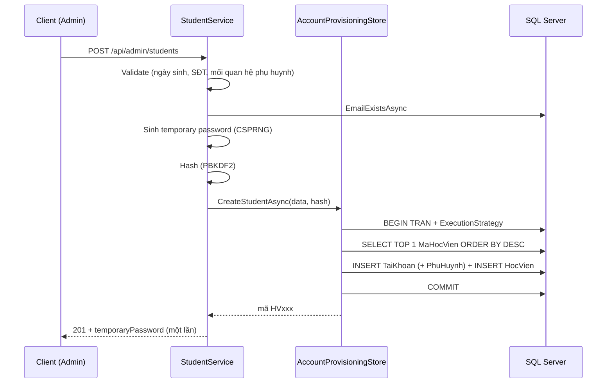

# Phase 3 — Account Management + Student/Teacher Profile

> Trạng thái: **HOÀN THÀNH** — build sạch 0 warning, **117/117 test assertion PASS** trên SQL Server thật.
> Không migration, không đổi schema.

## 1. Nghiệp vụ đã chốt

- ❌ **KHÔNG có public signup.** Không có `POST /api/auth/register*` nào.
- ✅ Chỉ **Quản trị viên** tạo tài khoản + hồ sơ.
- ✅ Backend **tự sinh mã đăng nhập**: `HVxxx` / `GVxxx` / `TGxxx`.
- ✅ Backend tự sinh **mật khẩu tạm** và trả về **đúng một lần**.
- ✅ Người dùng đăng nhập bằng mã được cấp, tự đổi mật khẩu qua `POST /api/auth/change-password` (Phase 2).

## 2. Quan hệ dữ liệu (KHÔNG đổi)

```
TaiKhoan.MaTaiKhoan   = PK kỹ thuật
TaiKhoan.TenDangNhap  = mã nghiệp vụ (UNIQUE, alternate key)
HocVien.MaHocVien     = TenDangNhap   ← luôn bằng nhau
GiaoVien.MaGiaoVien   = TenDangNhap   ← luôn bằng nhau
```

## 3. Kiến trúc

```
Domain/Constants/          RoleNames, AccountStatuses, StudentStatuses,
                           TeacherTypes, WorkStatuses
Application/Common/        PagedResult<T>, PagedQuery, OperationResult<T>,
                           WriteOutcome, TextValue
Application/Abstractions/  IAccountStore (mở rộng), IAccountProvisioningStore,
                           IStudentStore, ITeacherStore, ITemporaryPasswordGenerator
Application/Accounts/      IAccountAdminService + AccountAdminService + Models
Application/Students/      IStudentService + StudentService + Models
Application/Teachers/      ITeacherService + TeacherService + Models
Infrastructure/Persistence AccountStore, AccountProvisioningStore,
                           StudentStore, TeacherStore
Infrastructure/Authentication/TemporaryPasswordGenerator
Api/Controllers/           AdminAccounts, AdminStudents, AdminTeachers,
                           StudentProfile, TeacherProfile
Api/Extensions/            OperationResultExtensions (map kết quả -> HTTP)
```

Controller chỉ gọi service rồi `ToActionResult()` — không chứa logic.

## 4. Endpoints

### Admin — `[Authorize(Roles = RoleNames.QuanTriVien)]`

| Method | Path | Mô tả |
|---|---|---|
| GET | `/api/admin/accounts` | Danh sách: `page`, `pageSize`, `search`, `role`, `status` |
| GET | `/api/admin/accounts/{id}` | Chi tiết (kèm loại hồ sơ) |
| PATCH | `/api/admin/accounts/{id}/status` | Hoạt động / Bị khóa / Ngừng sử dụng |
| POST | `/api/admin/accounts/{id}/reset-password` | Trả mật khẩu tạm MỘT LẦN |
| DELETE | `/api/admin/accounts/{id}` | 204 nếu an toàn, **409** nếu có dữ liệu phụ thuộc |
| POST | `/api/admin/students` | Tạo học viên → **201** |
| GET | `/api/admin/students` | Danh sách học viên (paging/search/trạng thái) |
| GET | `/api/admin/students/{studentId}` | Chi tiết |
| PATCH | `/api/admin/students/{studentId}` | Cập nhật (kể cả TrangThaiHocTap, NgayNhapHoc) |
| POST | `/api/admin/teachers` | Tạo GV **hoặc** TG → **201** |
| GET | `/api/admin/teachers` | Danh sách (paging/search/loại) |
| GET | `/api/admin/teachers/{teacherId}` | Chi tiết + Bằng cấp + Chứng chỉ |
| PATCH | `/api/admin/teachers/{teacherId}` | Cập nhật (LoaiGiaoVien immutable) |

### Self profile

| Method | Path | Role |
|---|---|---|
| GET / PATCH | `/api/student/profile` | `Học viên` |
| GET / PATCH | `/api/teacher/profile` | `Giáo viên`, `Trợ giảng` |

**Không có tham số `studentId`/`teacherId`** trên self profile — danh tính lấy từ claim `unique_name` của JWT.

## 5. Flow tạo Học viên



Rollback toàn bộ nếu bất kỳ bước nào lỗi → **không có tài khoản mồ côi**.

## 6. Sinh mã concurrency-safe

**KHÔNG dùng `Count() + 1`** (đua nhau sẽ sinh trùng).

Cơ chế thực tế (3 lớp):

1. Mở **transaction** cho cả quá trình.
2. `SELECT TOP 1 MaHocVien ... WHERE MaHocVien LIKE 'HV[0-9][0-9][0-9]' ORDER BY MaHocVien DESC`
   → chỉ lấy **1 giá trị từ SQL Server**, không load danh sách. Do mã đã zero-padding 3 chữ số
   nên so sánh **chuỗi** cho cùng kết quả với so sánh **số**.
3. INSERT. Nếu SQL Server báo vi phạm UNIQUE (mã lỗi **2601/2627**) → ROLLBACK, xoá change tracker,
   **thử lại tối đa 5 lần** với mã kế tiếp.

**Phân biệt lỗi trùng MÃ hay trùng EMAIL mà KHÔNG dựa vào tên index** — vì tên UNIQUE constraint
trong database do SQL Server tự sinh (`UQ__TaiKhoan__A55F68FC075F61F7`) và **khác nhau giữa các máy**.
Thay vào đó: sau khi rollback, query lại xem email đã tồn tại chưa → nếu có là lỗi trùng email (trả 409),
ngược lại là trùng mã (thử lại).

**Kết quả test thật (CASE 6):** 5 request đồng thời → sinh ra `HV007, HV008, HV009, HV010, HV011` —
5 mã khác nhau, không trùng. CASE 9: 4 request đồng thời → `GV004..GV007`, không trùng.

> Giới hạn: hỗ trợ tối đa 999 mã mỗi loại. Vượt ngưỡng sẽ ném lỗi rõ ràng (cần thiết kế lại quy tắc mã).

## 7. Mật khẩu tạm

`TemporaryPasswordGenerator` — **CSPRNG** (`RandomNumberGenerator`), 12 ký tự:

| Đặc điểm | Giá trị |
|---|---|
| Độ dài | 12 |
| Bắt buộc có | chữ hoa + chữ thường + chữ số + ký tự đặc biệt |
| Bỏ ký tự dễ nhầm | `0 O 1 l I` |
| Sinh | `RandomNumberGenerator.GetInt32` + Fisher-Yates shuffle |
| Lưu DB | **CHỈ hash** (PBKDF2), không plain text |
| Trả về | **đúng 1 lần** trong response, **không log** |

Không dùng mặc định kiểu `123456`, `password`, mã tài khoản, ngày sinh, số điện thoại.
Không có endpoint `GET /temporary-password`.

## 8. Transaction

| Thao tác | Cách đảm bảo |
|---|---|
| Tạo Học viên (TaiKhoan + HocVien + PhuHuynh) | 1 transaction + `ExecutionStrategy` |
| Tạo Giáo viên (TaiKhoan + GiaoVien) | 1 transaction + `ExecutionStrategy` |
| Xóa tài khoản (hồ sơ + TaiKhoan) | 1 transaction + `ExecutionStrategy` |
| Đồng bộ Email 2 bảng | 1 lần `SaveChangesAsync` (EF tự bọc transaction ngầm định) |

> ⚠️ **Bài học quan trọng:** Phase 1 bật `EnableRetryOnFailure()`, nên EF Core **cấm**
> `BeginTransactionAsync` trần — phải bọc trong `Database.CreateExecutionStrategy().ExecuteAsync(...)`.
> Nếu không sẽ gặp lỗi:
> `The configured execution strategy 'SqlServerRetryingExecutionStrategy' does not support user-initiated transactions.`

## 9. Trạng thái tài khoản

`Hoạt động` / `Bị khóa` / `Ngừng sử dụng` — khớp CHECK `CK_TaiKhoan_TrangThai`. Giá trị khác → **400**.
Phase 2 login đã kiểm tra trạng thái nên khóa là có hiệu lực ngay.

**Chốt an toàn bổ sung:** Quản trị viên **không thể tự khóa** tài khoản đang đăng nhập (→ 400), tránh tự khóa mình khỏi hệ thống.

## 10. Reset mật khẩu

Admin → `POST /api/admin/accounts/{id}/reset-password` → sinh mật khẩu tạm **mới**, hash, cập nhật
`MatKhauHash` + `NgayCapNhat`, trả plain text **một lần**. Mật khẩu cũ hết hiệu lực ngay.

## 11. Pagination / Search / Filter

`PagedResult<T>` + `PagedQuery` (tự chuẩn hoá `page >= 1`, `1 <= pageSize <= 100`, mặc định 20).

```jsonc
{ "items": [], "page": 1, "pageSize": 20, "totalItems": 100, "totalPages": 5 }
```

- `search` → tìm trên **TenDangNhap + Email + HoTen** (LEFT JOIN cả 3 bảng hồ sơ).
- `role`, `status` → lọc chính xác.
- `CountAsync()` + `Skip()` + `Take()` đều chạy **ở SQL Server** — không load toàn bộ rồi phân trang ở memory.

## 12. Self profile

| | Học viên | Giáo viên / Trợ giảng |
|---|---|---|
| Được tự sửa | HoTen, GioiTinh, SoDienThoai, Email, DiaChi, MucTieuHocTap | HoTen, GioiTinh, SoDienThoai, Email, DiaChi |
| KHÔNG được sửa | MaHocVien, TrangThaiHocTap, NgayTaoHoSo, NgayNhapHoc, NgaySinh, vai trò, trạng thái tài khoản | MaGiaoVien, LoaiGiaoVien, ChuyenMon, SoNamKinhNghiem, NgayVaoLam, TrangThai, vai trò |

Cơ chế bảo vệ: các field bị cấm **không tồn tại** trong request DTO, và service chỉ map các field
hợp lệ sang request nội bộ → dù client có gửi thêm field lạ, JSON binder cũng **không bind**.
Đã kiểm chứng (CASE 24/25): gửi `trangThaiHocTap`, `maHocVien`, `trangThaiTaiKhoan`,
`loaiGiaoVien`, `chuyenMon`, `soNamKinhNghiem`, `trangThai` → **tất cả bị bỏ qua**, DB không đổi.

## 13. Đồng bộ Email

`TaiKhoan.Email` **luôn bằng** `HocVien.Email` / `GiaoVien.Email`.

Luồng: kiểm tra unique (trừ chính nó) → gán cho cả 2 entity tracked → **một** `SaveChangesAsync`
(EF bọc transaction ngầm định) → bắt `DbUpdateException` 2601/2627 cho race condition → trả **409**.

## 14. Xóa tài khoản (§22)

**Ưu tiên vô hiệu hoá, không hard-delete bừa.** `DELETE /api/admin/accounts/{id}`:

1. Xác định vai trò.
2. Kiểm tra dữ liệu phụ thuộc:
   - Học viên → `KiemTraDauVao`, `DangKyHoc`, `DiemDanh`, `PhanHoiDichVu`, `PhanHoiKhaoSat`
   - GV/TG → `PhanCongGiangDay`, `CaHoc`, `DiemSo` (Bằng cấp/Chứng chỉ có CASCADE nên không chặn)
   - Nhân viên → `LopHoc`, `DangKyHoc`, `ThanhToan`, `BienNhan`
   - Mọi vai trò → `DiemDanh`, `ThongBao`
3. Có dữ liệu → **409** + gợi ý dùng `Ngừng sử dụng`.
4. Không có → xóa hồ sơ + tài khoản trong 1 transaction → **204**.

Không thêm cột soft-delete. Kết quả test: tài khoản mới → **204**; `HV001` (6 bản ghi phụ thuộc) → **409** và **vẫn còn trong DB**.

## 15. Validation (đặt ở Application)

HoTen required (2–150) · Email required + đúng định dạng + unique · SĐT 8–20 ký tự và chỉ chứa
chữ số/`+ - . ( )` · NgaySinh không ở tương lai và >= 1900 · LoaiGiaoVien phải là "Giáo viên"/"Trợ giảng" ·
SoNamKinhNghiem >= 0 · TrangThaiTaiKhoan thuộc 3 giá trị hợp lệ · TrangThaiHocTap / TrangThai thuộc danh sách cho phép ·
**MoiQuanHe bắt buộc khi có phụ huynh** (khớp CHECK `CK_HocVien_PhuHuynh`).

## 16. Ghi chú thiết kế

| Quyết định | Lý do |
|---|---|
| **`LoaiGiaoVien` là IMMUTABLE** | `MaGiaoVien` = `TenDangNhap` đã gắn prefix `GV`/`TG`. Đổi loại phải đổi **khóa chính** và **mã đăng nhập** → làm hỏng dữ liệu lịch sử (phân công, ca học, điểm số). Muốn chuyển GV↔TG phải tạo tài khoản mới. Field này **không tồn tại** trong `UpdateTeacherRequest`. |
| **Không CRUD PhuHuynh** | `PhuHuynh` là quan hệ 1-N dùng chung: dữ liệu thật cho thấy `MaPhuHuynh=1` đang được **2 học viên** dùng cùng lúc. Cho một học viên sửa sẽ ảnh hưởng học viên khác. Phase 3 chỉ: xem trong profile + tạo kèm khi Admin tạo học viên. |
| **Không bắt đổi mật khẩu lần đầu** | Schema không có `MustChangePassword`; Phase 3 **không thêm cột** và **không giả lập**. Người dùng tự đổi qua Phase 2. |
| **Không public signup** | Đúng nghiệp vụ đã chốt. |
| **Không GenericRepository / UnitOfWork / MediatR / CQRS** | Chưa cần; các store chỉ có method hẹp đúng nhu cầu. |

## 17. Giá trị `TrangThaiHocTap` / `TrangThai` — ⚠️ CẦN XÁC NHẬN

Hai cột này **KHÔNG có CHECK constraint** trong database. Dữ liệu thật hiện có:

- `HocVien.TrangThaiHocTap`: `Đang tư vấn` (1), `Đang học` (3)
- `GiaoVien.TrangThai`: `Đang làm việc` (3)

Để không nhận giá trị rác từ client, code định nghĩa tập hợp cho phép trong
`StudentStatuses` / `WorkStatuses`:

| Constant | Giá trị | Nguồn |
|---|---|---|
| `StudentStatuses.DangTuVan` | `Đang tư vấn` | có trong DB |
| `StudentStatuses.DangHoc` | `Đang học` | có trong DB |
| `StudentStatuses.BaoLuu` | `Bảo lưu` | **suy đoán nghiệp vụ** |
| `StudentStatuses.DaNghi` | `Đã nghỉ` | **suy đoán nghiệp vụ** |
| `WorkStatuses.DangLamViec` | `Đang làm việc` | có trong DB |
| `WorkStatuses.DaNghiViec` | `Đã nghỉ việc` | **suy đoán nghiệp vụ** |

👉 **Cần bạn xác nhận** danh sách thật của trường. Nếu không đúng, chỉ cần sửa 2 file constant
(validation tự động theo) — **không cần đụng database**.

## 18. Kết quả test — **117/117 PASS**

| Nhóm | Case | Kết quả |
|---|---|---|
| Tạo học viên | CASE 1a–1n | ✅ 201, mã HVxxx, `MaHocVien == TenDangNhap`, hash thật `AQAAAA...`, login bằng mật khẩu tạm OK, đăng nhập bằng mật khẩu dev bị 401 |
| Phụ huynh | CASE 2a–2e | ✅ tạo + liên kết đúng, `MoiQuanHePhuHuynh` lưu, thiếu `moiQuanHe` → 400 |
| Email trùng | CASE 4 | ✅ 409 |
| Phân quyền | CASE 5, 8e | ✅ GV/HV tạo tài khoản → 403, không token → 401 |
| **Concurrency** | CASE 6, 9 | ✅ 5 request đồng thời → 5 mã khác nhau; 4 request GV đồng thời → 4 mã khác nhau |
| Tạo GV/TG | CASE 7, 8 | ✅ `GVxxx`+role Giáo viên; `TGxxx`+role Trợ giảng; loại sai → 400 |
| Danh sách TK | CASE 10–13 | ✅ phân trang, `pageSize` chặn ở 100, `page<1`→1, search username/mã, filter role/status, kết hợp |
| Khóa/mở | CASE 14, 15 | ✅ khóa → DB đổi + login 401; mở → khôi phục + login 200; status sai → 400; tự khóa mình → 400; GV → 403 |
| Reset password | CASE 16a–16h | ✅ mật khẩu mới khác cũ, cũ bị 401, mới OK, không lộ hash, id không tồn tại → 404 |
| Self profile | CASE 17–21 | ✅ HV001 xem đúng HV001 (+phụ huynh); GV001 → student profile 403; GV001/TG001 xem đúng; HV001 → teacher profile 403 |
| Đồng bộ Email | CASE 22, 23 | ✅ `TaiKhoan.Email == HocVien.Email` và `== GiaoVien.Email`; email trùng → 409 |
| **Leo quyền** | CASE 24, 25 | ✅ gửi field trái quyền → bị bỏ qua hoàn toàn, DB không đổi |
| Xóa tài khoản | DEL-1..6 | ✅ tài khoản mới → 204; `HV001` (6 phụ thuộc) → 409 và vẫn còn |
| Regression | REG-1..10 | ✅ health, health/database, database-info, login, /me, 401/403, change-password |

## 19. Tài khoản test đã tạo trong database

Chạy test đã tạo thêm tài khoản trong database (KHÔNG phải schema):

| Loại | Mã | Số lượng |
|---|---|---|
| Học viên | `HV005`, `HV006` (có phụ huynh), `HV007`–`HV011` (test đồng thời), `HV012` (test reset), `HV013` (test cập nhật/xóa) | 9 |
| Giáo viên | `GV003`, `GV004`–`GV007` (test đồng thời), `GV008` (test đồng bộ email) | 6 |
| Trợ giảng | `TG002` | 1 |

**Tổng: 16 tài khoản test** trên 11 tài khoản gốc → database có **27** tài khoản.

Mật khẩu của các tài khoản này là **mật khẩu tạm ngẫu nhiên** (chỉ hiển thị một lần khi tạo).
Có thể xóa bằng `DELETE /api/admin/accounts/{id}` (tài khoản mới chưa có dữ liệu nghiệp vụ → xóa được).

Dữ liệu gốc `ADMIN001`, `NVHV001`, `NVTV001`, `NVKT001`, `GV001`, `GV002`, `TG001`, `HV001`–`HV004`:
đã kiểm chứng **nguyên vẹn** sau test (xem §19b).

## 19b. Kiểm tra toàn vẹn dữ liệu sau khi test — **TẤT CẢ ĐẠT**

| Hạng mục | Kết quả | Đạt |
|---|---|---|
| Số bản ghi | TaiKhoan=27, HocVien=13, GiaoVien=10, NhanVien=4, VaiTro=7, PhuHuynh=4 | ✅ |
| 11 tài khoản gốc | tất cả `TrangThaiTaiKhoan = Hoạt động`, đúng vai trò, đúng email (HV001 đã được mở khóa lại) | ✅ |
| Đồng bộ email | `TaiKhoan.Email` vs `HocVien.Email` = **0 lệch**; vs `GiaoVien.Email` = **0 lệch** | ✅ |
| Mã trùng | **0** mã trùng trong `TaiKhoan.TenDangNhap`, `HocVien.MaHocVien`, `GiaoVien.MaGiaoVien` | ✅ |
| Mật khẩu | 27/27 hash **PBKDF2 thật** (bắt đầu `AQAAAA`), 0 bất thường, **không có plain text** | ✅ |
| Tài khoản mồ côi | **0** tài khoản HV/GV/TG thiếu hồ sơ tương ứng | ✅ |
| `MaHocVien` = `TenDangNhap` | đúng cho cả 13 học viên | ✅ |
| `MaGiaoVien` = `TenDangNhap` | đúng cho cả 10 giáo viên/trợ giảng | ✅ |
| Bảng `VaiTro` | 7 vai trò, ánh xạ 1–7 chính xác | ✅ |
| Build cuối | `Build succeeded` — **0 Warning(s), 0 Error(s)** | ✅ |

> Ghi nhận khi kiểm tra: tên cột thật trong database là `TaiKhoan.TrangThaiTaiKhoan` (không phải `TrangThai`),
> và `HocVien`/`GiaoVien` **không có** cột `MaTaiKhoan` — khóa ngoại nằm ở chính `MaHocVien`/`MaGiaoVien`
> trỏ tới `TaiKhoan.TenDangNhap` (alternate key). Code EF Core đã map đúng.

## 20. Chạy test

```powershell
# API phải đang chạy
dotnet run --project backend\LanguageCenter.Api\LanguageCenter.Api.csproj --launch-profile http
```

| Task VS Code | Nội dung |
|---|---|
| `phase3-recon` | đọc dữ liệu thật (read-only) |
| `phase3-diag` | chẩn đoán nhanh API + login |
| `phase3-test-part1` | tạo học viên/GV/TG + concurrency + phân quyền |
| `phase3-test-part2` | quản lý tài khoản + self profile + đồng bộ email + xóa + regression |
| `phase3-verify2` | kiểm tra toàn vẹn dữ liệu sau test (đọc thẳng SQL Server) |
